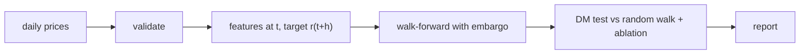
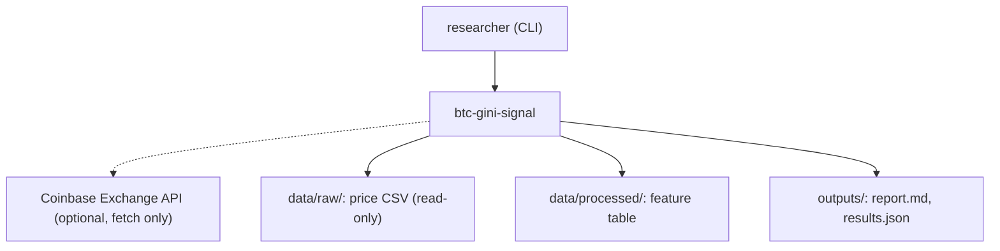
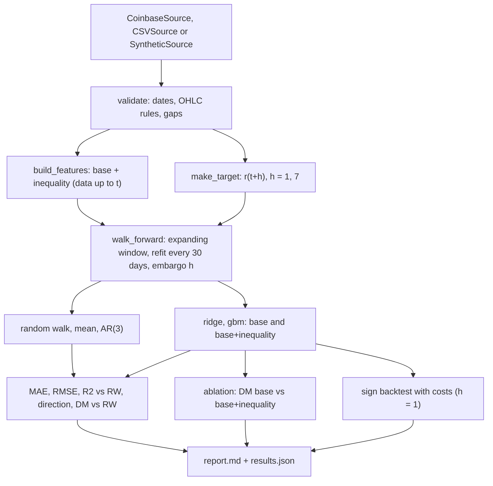

<div align="center">

# btc-gini-signal — Inequality Features for Bitcoin Return Forecasts

**btc-gini-signal is a walk-forward research harness for Bitcoin return forecasts. It takes daily prices through these steps to an ablation report:**

`fetch` → `validate` → `compute features` → `walk-forward` → `compare with the random walk` → `report`.


**[Summary](#1-summary)** ·
**[Workflow](#4-the-end-to-end-workflow)** ·
**[Run it](#10-how-to-run-btc-gini-signal)** ·
**[Configuration](#104-environment-variables)** ·
**[Known problems](#13-known-problems)** ·
**[Glossary](#15-glossary)**

</div>

> [!NOTE]
> This README uses ASD-STE100 Simplified Technical English. The writing rules and the project
> vocabulary are in [`docs/ste-style-guide.md`](docs/ste-style-guide.md). Each term in the
> [Glossary](#15-glossary) has only one meaning.

---

btc-gini-signal asks one question: do the Gini index and the Kolkata index of recent absolute returns improve Bitcoin return forecasts? It answers with an ablation. Each model runs with and without the inequality features, in a walk-forward evaluation, against the random walk. Every feature at day t uses only data up to day t, and a test proves it.

This README is the **one location that explains all of btc-gini-signal**. It gives these topics:

- the general design
- each component and its procedure, step by step
- the decision rules
- the data map
- the runbook
- the validation results and the known problems

| If you are… | Read |
|---|---|
| A manager or reviewer | [1](#1-summary), [3](#3-design-rules), [4](#4-the-end-to-end-workflow), [12](#12-validation-results), [14](#14-key-points) |
| A developer who joins the project | All sections, in sequence. Keep [10](#10-how-to-run-btc-gini-signal) and [13](#13-known-problems) open while you work |
| An operator who runs btc-gini-signal | [10](#10-how-to-run-btc-gini-signal), then the section for the component that you use |

> [!WARNING]
> Do not use btc-gini-signal for trading decisions. It is research code, not financial advice. The backtest ignores slippage, funding, taxes and market impact.

---

## Table of contents

1. 🧭 [Summary](#1-summary)
2. 🏗️ [How btc-gini-signal is built](#2-how-btc-gini-signal-is-built)
   - 2.1 [Components](#21-components)
   - 2.2 [System context](#22-system-context)
   - 2.3 [Repository layout](#23-repository-layout)
3. 🛡️ [Design rules](#3-design-rules)
4. 🔄 [The end-to-end workflow](#4-the-end-to-end-workflow)
   - 4.1 [Full flow](#41-full-flow)
   - 4.2 [The life cycle of one forecast](#42-the-life-cycle-of-one-forecast)
5. 🔵 [Price data and validation](#5-price-data-and-validation)
6. 🟢 [Features and targets](#6-features-and-targets)
7. 🟣 [Models and the walk-forward evaluation](#7-models-and-the-walk-forward-evaluation)
8. ⚖️ [The metrics, the tests and the backtest](#8-the-metrics-the-tests-and-the-backtest)
9. 🗂️ [Data and file map](#9-data-and-file-map)
10. ▶️ [How to run btc-gini-signal](#10-how-to-run-btc-gini-signal)
    - 10.1 [Prerequisites](#101-prerequisites) · 10.2 [Installation](#102-installation) · 10.3 [Run btc-gini-signal](#103-run-btc-gini-signal) · 10.4 [Environment variables](#104-environment-variables)
11. 🧩 [How to extend btc-gini-signal](#11-how-to-extend-btc-gini-signal)
12. ✅ [Validation results](#12-validation-results)
13. ⚠️ [Known problems](#13-known-problems)
14. 📌 [Key points](#14-key-points)
15. 📖 [Glossary](#15-glossary)
16. 📄 [License](#16-license)

---

## 1. Summary

**The problem.** A price model with R² near 1 looks perfect. But a same-day price is a reconstruction, not a forecast. These questions are difficult:

- Does each feature use only data that is known on the forecast day?
- Does a model beat the random walk on future returns?
- Do the inequality features reduce the error, with the same model and the same days?
- Is a difference larger than the noise?

btc-gini-signal gives each of these questions its own component. A truncation test guards the features, the walk-forward evaluation uses an embargo, and the Diebold-Mariano test measures each difference.

| Item | Value |
|---|---|
| Input | Daily OHLCV prices: the Coinbase Exchange API, an Investing.com export, a generic CSV or synthetic prices |
| Output | `report.md` and `results.json` (accuracy, ablation, backtest), a feature table, a multi-horizon forecast |
| Components | **12** modules: config, data, synthetic, features/inequality, features/build, models, walkforward, metrics, study, forecast, report, cli |
| Providers | Coinbase Exchange public API (optional, no key) |
| Offline mode | All commands except `fetch`. The synthetic generator replaces the download |
| Safety | Features use data up to day t only. Training targets are observed before the first predicted day. Raw files are read-only |
| Tests | **48** unit tests (`pytest`), all offline |



---

## 2. How btc-gini-signal is built

### 2.1 Components

| Component | Module | Purpose |
|---|---|---|
| Settings | `src/btc_gini_signal/config.py` | Read `BTCGINI_*` variables and a local `.env` file. Reject a horizon below 1 day |
| Price data | `src/btc_gini_signal/data.py` | `CSVSource`, `CoinbaseSource` and `SyntheticSource` behind one `PriceSource` interface. Parse, validate and record provenance |
| Generator | `src/btc_gini_signal/synthetic.py` | GARCH-style returns with jumps and an optional planted inequality signal |
| Inequality indices | `src/btc_gini_signal/features/inequality.py` | Lorenz curve, Gini index, Kolkata index, rolling versions |
| Feature table | `src/btc_gini_signal/features/build.py` | Base features, inequality features and targets |
| Models | `src/btc_gini_signal/models.py` | Random walk, mean, AR(3), ridge, gradient boosting. Imputation and scaling inside a `Pipeline` |
| Walk-forward | `src/btc_gini_signal/walkforward.py` | Expanding window, refit schedule, embargo |
| Metrics | `src/btc_gini_signal/metrics.py` | MAE, RMSE, R² against the random walk, direction accuracy, Diebold-Mariano, sign backtest |
| Study | `src/btc_gini_signal/study.py` | All horizons, models and feature sets on the same days. The ablation |
| Forecast | `src/btc_gini_signal/forecast.py` | Direct multi-step forecast from the last day |
| Report | `src/btc_gini_signal/report.py` | `report.md` and `results.json` |
| CLI | `src/btc_gini_signal/cli.py` | The `btc-gini-signal` command with 7 subcommands |

### 2.2 System context



### 2.3 Repository layout

```
btc-gini-signal/
├── src/btc_gini_signal/    the package
│   └── features/           inequality.py (Gini, Kolkata) and build.py (features, targets)
├── tests/                  48 pytest tests, synthetic data and a fake HTTP client
├── data/README.md          sources, terms, formats, validation rules
├── docs/ste-style-guide.md writing rules and project vocabulary
├── .github/workflows/      ci.yml: pytest on Python 3.11
├── .env.example            names of the environment variables
└── pyproject.toml          package and the btc-gini-signal entry point
```

---

## 3. Design rules

### 3.1 Forecast future returns, not same-day prices
The target is the log return from day t to day t + h, with h of 1 day or more. `parse_horizons` rejects a horizon of 0. The training target and the scoring target are the same series.

### 3.2 Features use the past only
Each feature at day t uses closes up to day t. A test computes the features on a truncated price series and checks that the values do not change. A second test changes future prices and checks the past features.

### 3.3 The embargo
At a refit day, the model trains only on days t with t + h on or before that refit day. Only those targets are known on that day. A test checks this rule for each refit.

### 3.4 Scale-free inequality on a fixed window
The Gini and Kolkata indices use the absolute log returns of the last `BTCGINI_WINDOW` days. Returns do not depend on the price level, so the features do not drift with the price. A test multiplies all prices by 1000 and checks the features.

### 3.5 The random walk is the reference
Every model is compared with a zero-return forecast. R² is computed against that forecast, so a negative value means "worse than no change". The Diebold-Mariano test gives the p-value.

### 3.6 Raw data is read-only
The loaders only read files. `features` refuses to write over its input file or into a `raw` folder. `fetch` refuses to overwrite an existing file without `--force`.

### 3.7 The pipeline owns all preprocessing
The median imputer and the scaler are steps of the model pipeline. They fit again at each refit, on the training days only.

---

## 4. The end-to-end workflow

### 4.1 Full flow



### 4.2 The life cycle of one forecast

1. The loader reads the day from the price file and validates it.
2. The feature builder computes the base and inequality features of the day from past closes.
3. The walk-forward loop finds the last refit day on or before this day.
4. At that refit day, the model trained on days whose target was already known.
5. The model predicts the return from this day to this day plus h.
6. The study compares the prediction with the realised target and with the random walk.
7. For h = 1, the backtest holds the sign of the prediction for the next day and charges the cost.

---

## 5. Price data and validation

**Purpose.** Read daily prices from one of three sources into one canonical frame, and stop bad data.

| Input | Output |
|---|---|
| A CSV file, the Coinbase API or the generator | `PriceData`: the canonical frame (`date`, `open`, `high`, `low`, `close`, `volume`), provenance, warnings |

**Procedure**

1. Detect the layout: Investing.com (`Price` column) or generic (`close` column).
2. Parse numbers with thousands separators, `K`, `M` and `B` suffixes and percent signs.
3. Sort the days oldest-first and normalise each date to a UTC calendar day.
4. Validate the frame. Stop with a `DataError` if an error exists.
5. Record the provenance: source, detail, day boundary and notes.

**Rules**

- Duplicate dates, unsorted dates, missing prices and prices of 0 or less are errors.
- A `low` above `open` or `close`, or a `high` below them, is an error.
- A calendar gap is a warning. The return of the next day spans the gap.
- `CoinbaseSource` asks for 300 days per request and fails on an error payload.

---

## 6. Features and targets

**Purpose.** Make inputs that use only the past, and targets that are in the future.

| Input | Output |
|---|---|
| The canonical frame | A feature table indexed by date, and one target series per horizon |

**Procedure**

1. Compute the daily log return r(t) = log(close[t] / close[t-1]).
2. Compute the base features from r up to day t.
3. Compute the Gini and Kolkata indices of |r| over the last `window` days.
4. Compute the target y_h(t) = log(close[t+h] / close[t]). The last h days have no target.

| Feature | Group | Definition |
|---|---|---|
| `ret_lag1`, `ret_lag2`, `ret_lag3`, `ret_lag5` | base | r(t), r(t-1), r(t-2), r(t-4) |
| `ret_7d` | base | Sum of the last 7 returns |
| `vol_7`, `vol_30` | base | Standard deviation of the last 7 and 30 returns |
| `skew_30`, `kurt_30` | base | Skewness and excess kurtosis of the last 30 returns |
| `range_log` | base | log(high / low) of day t |
| `gini_abs_ret` | inequality | Gini index of the last `window` absolute returns |
| `kolkata_abs_ret` | inequality | Kolkata index of the same values |
| `gini_change_7` | inequality | `gini_abs_ret` minus its value 7 days earlier |

| Index | Equal values | One value holds all |
|---|---|---|
| Gini | 0 | (n - 1) / n |
| Kolkata | 0.5 | approaches 1 |

---

## 7. Models and the walk-forward evaluation

**Purpose.** Measure each model on days that it did not see, with the same days for every model.

| Input | Output |
|---|---|
| The feature table, one target, a model and a feature set | A `WalkForwardResult`: dates, realised targets, predictions and the refit log |

**Procedure**

1. Keep the days with complete features (union of all feature sets) and an observed target.
2. Use the first `min_train` usable days for the first fit.
3. At each refit day, train on the usable days t with t + h on or before the refit day.
4. Predict the next `refit_every` days with that model.
5. Repeat to the end of the series.

**Rules**

- All models and both feature sets use the same evaluation days, so the comparisons are paired.
- `ar` always uses `ret_lag1`, `ret_lag2` and `ret_lag3` only.
- `random_walk` and `mean` ignore the features.

| Model | Description |
|---|---|
| `random_walk` | Zero return. The reference |
| `mean` | Mean training return (drift) |
| `ar` | AR(3): least squares on the last three returns |
| `ridge` | Ridge regression, alpha chosen by internal CV from 13 values (0.01 to 10,000) |
| `gbm` | Histogram gradient boosting: depth 3, rate 0.03, 150 iterations, at least 40 days per leaf |

---

## 8. The metrics, the tests and the backtest

| Metric | Meaning | Better |
|---|---|---|
| MAE, RMSE | Errors of the predicted log return | Lower |
| R² vs RW | 1 - SSE(model) / SSE(zero forecast) | Above 0 |
| Direction accuracy | Share of days with the correct sign (zero predictions are skipped) | Above 0.5 |
| DM vs RW | Diebold-Mariano statistic for squared errors. Positive = the model has a smaller loss | Positive, with p < 0.05 |
| Ablation DM | Same test, base+inequality against base, same model, same days | Positive, with p < 0.05 |

| Test rule | Value in the code |
|---|---|
| Long-run variance | Autocovariances up to lag h - 1 (overlapping h-day errors) |
| Small-sample correction | Harvey-Leybourne-Newbold factor |
| p-value | Two-sided, t distribution with n - 1 degrees of freedom |
| Multiple comparisons | Not adjusted. The report says so |

| Backtest rule | Value in the code |
|---|---|
| Horizon | 1 day only |
| Position | sign(prediction): +1, 0 or -1 (`long_only` gives 1 or 0) |
| Cost | `BTCGINI_COST_BPS` basis points per unit change of the position (default 10) |
| Annualisation | 365 days |
| Reference | Buy and hold on the same days |

---

## 9. Data and file map

| Path | Committed? | Contents |
|---|---|---|
| `data/README.md` | Yes | Sources, terms, formats and validation rules |
| `data/raw/*.csv` | No (git ignores it) | Downloaded or synthetic prices. Read-only for the code |
| `data/processed/features.csv` | No (git ignores it) | Feature table with the targets |
| `outputs/report.md` | No (git ignores it) | Accuracy, ablation and backtest tables |
| `outputs/results.json` | No (git ignores it) | All numbers, settings, provenance and the data hash |
| `.env` | No (git ignores it) | Local settings |

---

## 10. How to run btc-gini-signal

### 10.1 Prerequisites

| Need | For |
|---|---|
| Python 3.11+ | All components |
| Internet access | Only `fetch` (Coinbase Exchange public API, no key) |

### 10.2 Installation

```bash
git clone https://github.com/KrishnaAnnavaram/btc-gini-signal.git
cd btc-gini-signal
python -m venv .venv
. .venv/bin/activate            # Windows: .venv\Scripts\activate
pip install -e ".[dev]"
```

### 10.3 Run btc-gini-signal

```bash
# offline demo: 2500 synthetic days, horizons 1 and 7, all models
btc-gini-signal demo

# real prices from the public Coinbase API
btc-gini-signal fetch --start 2016-01-01 --end 2025-12-31 --out data/raw/btc_usd_coinbase.csv
btc-gini-signal validate --data data/raw/btc_usd_coinbase.csv
btc-gini-signal evaluate --data data/raw/btc_usd_coinbase.csv --out outputs/coinbase
btc-gini-signal features --data data/raw/btc_usd_coinbase.csv --horizons 1,7
btc-gini-signal forecast --data data/raw/btc_usd_coinbase.csv --horizons 1,7 --model ridge

# planted-signal check: the harness must find this effect
btc-gini-signal evaluate --data synthetic --signal 4 --horizons 1 --models random_walk,ridge

pytest -q
```

| Command | What it does |
|---|---|
| `btc-gini-signal demo` | Runs `evaluate` on synthetic prices (`--signal 0`) |
| `btc-gini-signal synth` | Writes synthetic prices (`--days`, `--seed`, `--signal`, `--out`) |
| `btc-gini-signal fetch` | Downloads daily candles (`--start`, `--end`, `--product`, `--out`, `--force`) |
| `btc-gini-signal validate` | Checks a price CSV. Exit code 1 on errors |
| `btc-gini-signal features` | Writes the feature and target table to `data/processed/` |
| `btc-gini-signal evaluate` | Runs the walk-forward study and writes the report (`--models`, `--horizons`, `--min-train`, `--refit-every`, `--cost-bps`) |
| `btc-gini-signal forecast` | Prints a direct forecast for each horizon from the last day |

### 10.4 Environment variables

| Variable | Used by | Meaning |
|---|---|---|
| `BTCGINI_DATA` | data | Price CSV path. If empty, the commands use synthetic prices |
| `BTCGINI_OUTPUT_DIR` | report | Output folder of `evaluate` (default `outputs`) |
| `BTCGINI_PROCESSED_DIR` | features | Folder for the feature table (default `data/processed`) |
| `BTCGINI_SEED` | generator, gbm | Random seed (default 42) |
| `BTCGINI_HORIZONS` | targets | Comma list of horizons in days, each 1 or more (default `1,7`) |
| `BTCGINI_WINDOW` | inequality features | Window in days, 5 or more (default 30) |
| `BTCGINI_MIN_TRAIN` | walk-forward | Usable days before the first fit, 50 or more (default 730) |
| `BTCGINI_REFIT_EVERY` | walk-forward | Days between refits (default 30) |
| `BTCGINI_COST_BPS` | backtest | Cost in basis points per unit turnover (default 10) |

btc-gini-signal uses no credentials. A local `.env` file is optional, and git ignores it.

---

## 11. How to extend btc-gini-signal

| You want to… | Do this | Code change? |
|---|---|---|
| Change the window, horizons or refit schedule | Set the `BTCGINI_*` variables or the CLI options | No |
| Use another coin from Coinbase | `fetch --product ETH-USD` | No |
| Add a feature | Add a column in `build_features` and a name in `BASE_FEATURES` or `INEQUALITY_FEATURES`. Add it to the truncation test | Small |
| Add a model | Add a `ModelSpec` to `MODELS` in `models.py` | Small |
| Add a data source | Write a class with `name` and `read()` that returns the canonical frame and a `Provenance` | Small |
| Add a sequence model (LSTM) | Wrap it as a scikit-learn regressor with lazy imports, then add a `ModelSpec` | Yes |

---

## 12. Validation results

| Validation | Result | Command |
|---|---|---|
| Unit tests | **48 passed**, 0 skipped | `pytest -q` |
| Synthetic demo, no planted signal, h = 1 | No model beats the random walk (all DM p ≥ 0.13). Ablation: ridge DM -0.60, gbm DM -0.96 | `btc-gini-signal demo` |
| Synthetic demo, no planted signal, h = 7 | Ablation: ridge DM +1.25 (p 0.211), gbm DM -0.14 (p 0.886) | `btc-gini-signal demo` |
| Synthetic, planted signal 4, h = 1 | Ablation: ridge DM +4.93 (p < 0.001). The harness finds a real effect | `btc-gini-signal evaluate --data synthetic --signal 4 --horizons 1 --models random_walk,ridge` |
| Coinbase BTC-USD, 2016-01-01 to 2025-12-31 (local run), h = 1 | 2,885 test days. Random walk RMSE 0.03428. Ridge base and base+inequality RMSE 0.03430, R² vs RW -0.0014 | `btc-gini-signal evaluate --data data/raw/btc_usd_coinbase.csv` |
| Same data, ablation | h = 1: ridge DM +0.03 (p 0.974), gbm DM -0.05 (p 0.958). h = 7: ridge DM -1.35 (p 0.177), gbm DM -0.94 (p 0.349) | same |
| Same data, gbm vs random walk | h = 1: DM -1.98 (p 0.048). h = 7, base+inequality: DM -2.40 (p 0.016). The model is worse than the random walk | same |
| Same data, sign backtest h = 1, 10 bps | Ridge base: total log return 2.699, Sharpe 0.52. Ridge base+inequality: 2.259, Sharpe 0.44. Buy and hold: 2.432, Sharpe 0.47 | same |

**What the numbers show.** On real Coinbase prices, the Gini and Kolkata features do not reduce the forecast error at horizon 1 or 7. No model beats the random walk with significance. The planted-signal run shows that the harness can detect an effect of this type when the effect exists.

**What the numbers do not show.** The Coinbase rows come from one local run. CI does not reproduce them, because git does not store price data. The prototype reported R² near 1 for same-day prices (prototype result, not reproduced here). That value came from reconstruction of the same-day close, not from a forecast.

---

## 13. Known problems

Read these problems before you use btc-gini-signal in production.

| # | Area | Problem | Impact and action |
|---|---|---|---|
| 1 | CI | CI tests only synthetic prices and a fake HTTP client. | The Coinbase results are not reproduced in CI. Run `fetch` and `evaluate` locally |
| 2 | Statistics | The DM tests are not adjusted for many comparisons. | With 14 rows and 4 ablations, one p below 0.05 can occur by chance. Read the pattern, not one value |
| 3 | Data | One exchange (Coinbase) and one day boundary (UTC). | Other venues and other boundaries give other numbers. Record the source with each result |
| 4 | Backtest | No slippage, funding, borrow cost, taxes or market impact. | The backtest is an upper limit. Do not trade on it |
| 5 | Regimes | One expanding window over all history. | A model can adapt slowly to a new regime. A rolling training window is not implemented |
| 6 | Scope | No LSTM or other sequence model. | The plan lists it as optional. Add it as an extra (see section 11) |
| 7 | API | `fetch` depends on the public Coinbase API and its limits. | If the API changes or limits requests, `fetch` fails with a clear error. Use a CSV export instead |

---

## 14. Key points

1. **The target is a future return.** A same-day price is not a forecast, and the configuration rejects a horizon of 0.
2. **Features use only the past.** A truncation test proves it for every feature.
3. **The embargo keeps unknown targets out of training.** Each refit uses only targets that are known on that day.
4. **The random walk is the reference.** R², the DM test and the backtest all compare with it.
5. **The ablation answers the question.** On Coinbase prices from 2016 to 2025, the inequality features did not help.
6. **This is research code.** It is not financial advice.

---

## 15. Glossary

| Term | Meaning |
|---|---|
| **Ablation** | The comparison of one model with and without the inequality features, on the same days |
| **Backtest** | The simulation of a sign strategy with costs on 1-day forecasts |
| **Close** | The last price of a day |
| **DM test** | Diebold-Mariano test: compares the losses of two forecasts on the same days |
| **Embargo** | The rule that a training day t has t + h on or before the first predicted day |
| **Feature** | One input column computed from data up to day t |
| **Gini index** | 1 minus 2 times the area under the Lorenz curve |
| **Horizon** | The number of days h between the forecast day and the target day |
| **Inequality features** | `gini_abs_ret`, `kolkata_abs_ret` and `gini_change_7` |
| **Kolkata index** | The x-coordinate k where the Lorenz curve meets the line 1 - p |
| **Lorenz curve** | The share of the total held by the smallest fraction p of the values |
| **Random walk** | The model that forecasts a zero return |
| **Refit** | One new fit of a model on all days that are available on that day |
| **Return** | The log return log(close[t] / close[t-1]) |
| **Target** | The future log return log(close[t+h] / close[t]) |
| **Walk-forward** | The evaluation in which each model trains on past days only and predicts the next block of days |
| **Window** | The number of past days for the inequality features |

---

## 16. License

[MIT](LICENSE) © 2026 Krishna Annavaram
